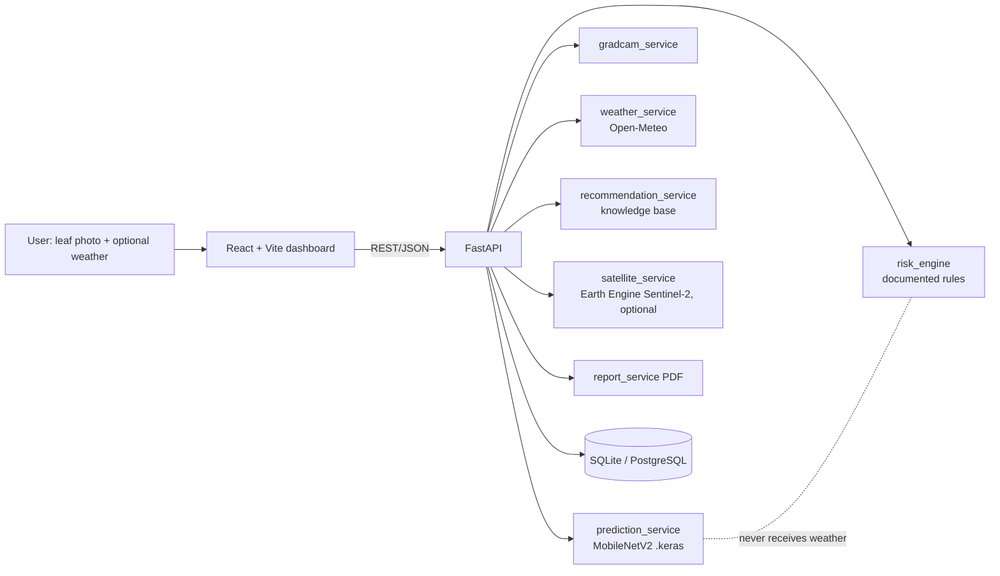
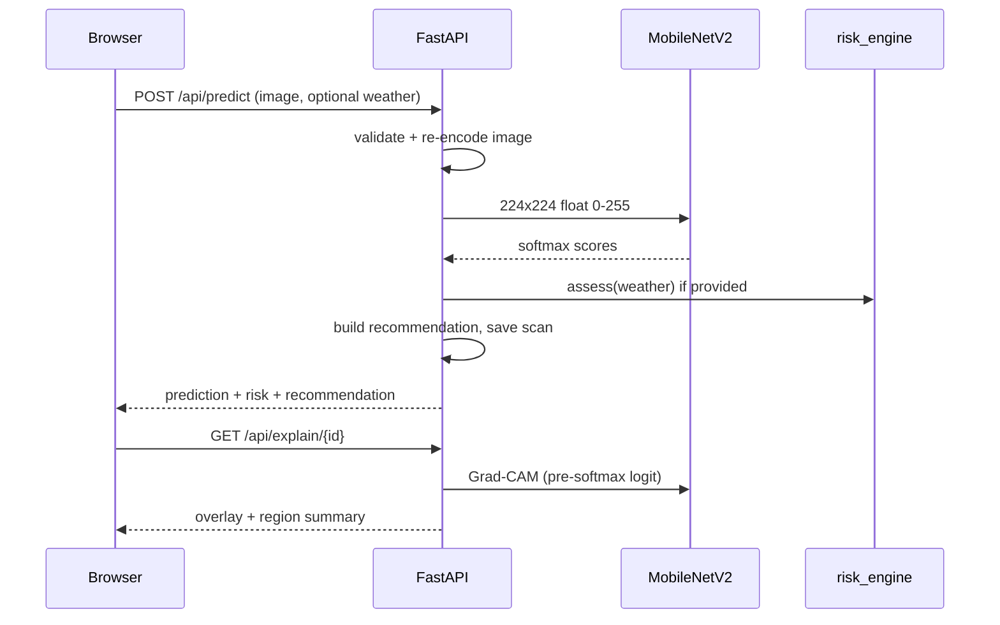

# Architecture

The image model and the environmental engine are independent. The decision-support layer only *places their outputs side by side* and builds recommendations from (predicted class, confidence, rule-based risk).

## Training pipeline
PlantVillage -> `prepare_data.py` (validate, dedupe by MD5, stratified 70/15/15, seed 42) -> `train.py` (baseline CNN or MobileNetV2: frozen backbone, optional fine-tune of last 30 layers with BatchNorm frozen, early stopping) -> `evaluate.py` (test split, optional PlantDoc field images).

## Data sources and their role
| Source | Role | Linked to the CNN? |
|---|---|---|
| PlantVillage | Labelled leaf images, trains/evaluates classifier | Yes |
| PlantDoc (optional) | Field images for generalisation test | Evaluation only |
| Open-Meteo | Current/forecast/historical weather for context | No |
| Sentinel-2 via Earth Engine | Field-level NDVI/NDMI indicators | No |
